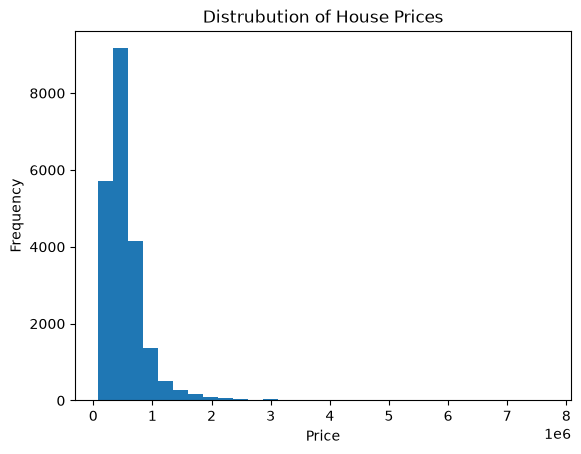
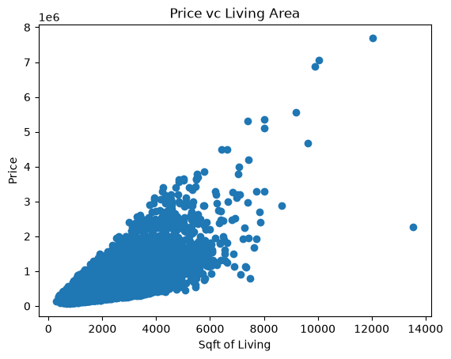
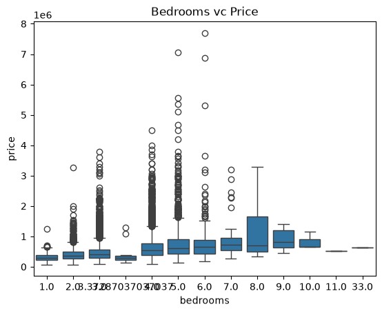
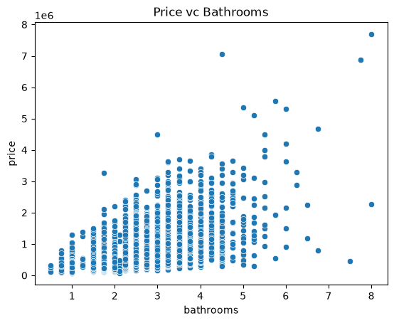
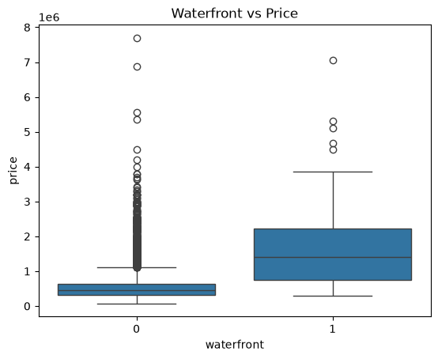
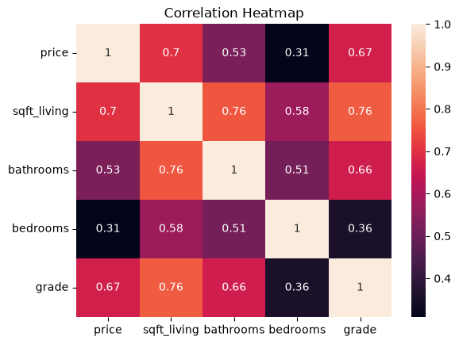

<h1 align="center">🏠 Smart Real Estate Price Analysis</h1>

<p align="center">
  A Python-based exploratory data analysis project focused on understanding housing prices,
  identifying influential property characteristics, and transforming raw housing data into actionable insights.
</p>

<p align="center">
  
  
  
  
  
  
</p>

---

## 📖 About the project

Buying or selling a house is a big decision, and the price depends on a lot of things: size, number of rooms, quality, location. I wanted to find out which of these actually matter the most, so I took the King County house sales dataset (21,613 houses) and went through it step by step in Jupyter Notebook.

The question behind the whole project is simple:

> **What makes a house expensive?**

The dataset had some missing values, so part of the work was cleaning it before I could start looking for answers.

---

## 🗂️ Dataset

- **File:** `kc_house_data_NaN.csv`
- **Rows:** 21,613 houses
- **Columns:** 22
- **Target:** `price`

The main columns I looked at:

- **Size:** `sqft_living`, `sqft_lot`
- **Structure:** `bedrooms`, `bathrooms`, `floors`
- **Quality:** `grade`, `condition`
- **Location:** `zipcode`, `waterfront`, `view`
- **Construction:** `yr_built`, `yr_renovated`

---

## 🧹 What I did

**1. Loaded and checked the data.** Read the CSV with Pandas and looked at the shape, data types and summary numbers.

**2. Cleaned it up.** Dropped the extra `Unnamed: 0` column, which was just an index, and converted the `date` column to a proper date format.

**3. Dealt with the missing values.** Only two columns had any: `bedrooms` (13 missing) and `bathrooms` (10 missing). I filled both with the mean of their column and checked again afterwards to make sure nothing was left empty.

**4. Explored it with charts.** Used a histogram, scatter plots, box plots and a correlation heatmap to answer 6 questions about house prices.

---

## ❓ Questions I answered

**Q1. How are house prices spread out?**

➡️ Most houses are mid-priced and very few are luxury. The median price is $450,000.

**Q2. Does a bigger living area mean a higher price?**

➡️ Yes, bigger houses usually cost more.

**Q3. Do more bedrooms mean a higher price?**

➡️ Yes, up to a point. The price growth slows down after about 6 bedrooms.

**Q4. Do bathrooms matter?**

➡️ Yes, they have a strong effect on price, stronger than bedrooms.

**Q5. Is a waterfront house costlier?**

➡️ Yes, much costlier. The median waterfront house sells for $1.4 million, against $450,000 for the rest.

**Q6. What is linked most with price?**

➡️ Living area (`sqft_living`), with a correlation of 0.70.

---

## 📊 Charts and what they show

### Distribution of house prices



The chart is skewed to the right. The average price is about $540,000 and the median is $450,000, and around 93% of the houses cost less than $1 million. The expensive ones stretch the tail all the way up to $7.7 million, but there are very few of them.

### Price vs living area



The dots climb from the bottom left to the top right, so a larger living area usually means a higher price. The correlation is 0.70, which is strong.

### Bedrooms vs price



The typical price rises with each extra bedroom, from about $299,000 for 1 bedroom to about $650,000 for 6. After that it stops rising steadily, and there are only a handful of houses with that many bedrooms anyway.

### Bathrooms vs price



Prices go up as the bathroom count goes up. Bathrooms have a correlation of 0.53 with price, while bedrooms only have 0.31, so bathrooms say more about the price than bedrooms do.

### Waterfront vs price



Only 163 of the 21,613 houses are on the waterfront, but they are in a different price league. Their median price is $1.4 million, which is roughly three times the median of the others. A waterfront is clearly a premium feature.

### Correlation heatmap



Living area has the strongest link with price (0.70), followed closely by grade (0.67). Bathrooms come next (0.53) and bedrooms are last (0.31). If I had to pick one number to estimate a price, it would be living space.

---

## 💡 Main takeaways

1. Living area is the biggest factor behind a house's price.
2. Bathrooms matter more than bedrooms.
3. Better quality (a higher grade) means a higher price.
4. Waterfront, view and renovation are what make a house premium.
5. Luxury houses are rare. The market is mostly made of affordable properties.

---

## 🚀 What this means for people

- **Sellers:** Show off the living space and the build quality, they raise the price.
- **Buyers:** Look at the living area first, not just the number of bedrooms.
- **Agents:** Advertise waterfront and view houses as premium homes.
- **Investors:** Quality and space are good things to look for.

---

## ⚠️ Limitations

- This is a basic analysis and there is no price prediction model.
- Location is studied in a simple way.
- Price changes over time (inflation) are not considered.

---

## 📁 Project structure

```
Real-Estate-Price-Analytics
|-- Real_Estate_Price_Analytics.ipynb
|-- Real_Estate_Price_Analytics.html
|-- kc_house_data_NaN.csv
|-- README.md
`-- Images
    |-- price_distribution.png
    |-- price_vs_living_area.png
    |-- bedrooms_vs_price.png
    |-- bathrooms_vs_price.png
    |-- waterfront_vs_price.png
    `-- correlation_heatmap.png
```

---

## ▶️ Running it yourself

```bash
git clone https://github.com/your-username/Real-Estate-Price-Analytics.git
cd Real-Estate-Price-Analytics
pip install pandas numpy matplotlib seaborn jupyter
jupyter notebook Real_Estate_Price_Analytics.ipynb
```

Then pick **Kernel → Restart & Run All**. Keep the CSV file in the same folder as the notebook.

---

## 🧾 Wrapping up

This project turned raw housing data with a few missing values into clean data and simple answers. Size, bathrooms, quality and a waterfront location are what really move a house's price, which can help buyers, sellers and real estate companies make better decisions.

